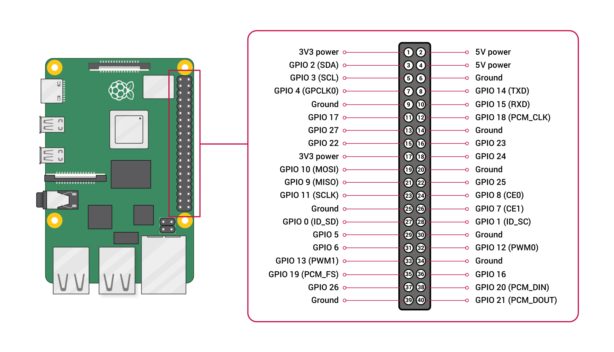

component pin -> raspi pin

Fan:
- \+ -> 4
- \- -> 6

Keypad:
- 1 -> 40
- 2 -> 38
- 3 -> 36
- 4 -> 32
- 5 -> 28
- 6 -> 18
- 7 -> 16
- 8 -> 22

Display:
- vcc -> 2
- gnd -> 9
- din -> 19
- clk -> 23
- cs -> 24
- dc -> 15
- rst -> 13
- bl -> 12

gpio reference:

